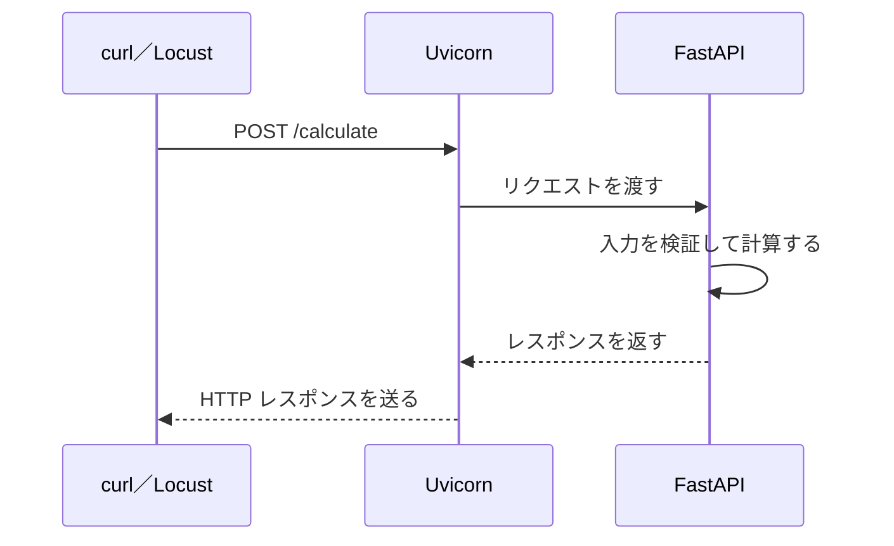
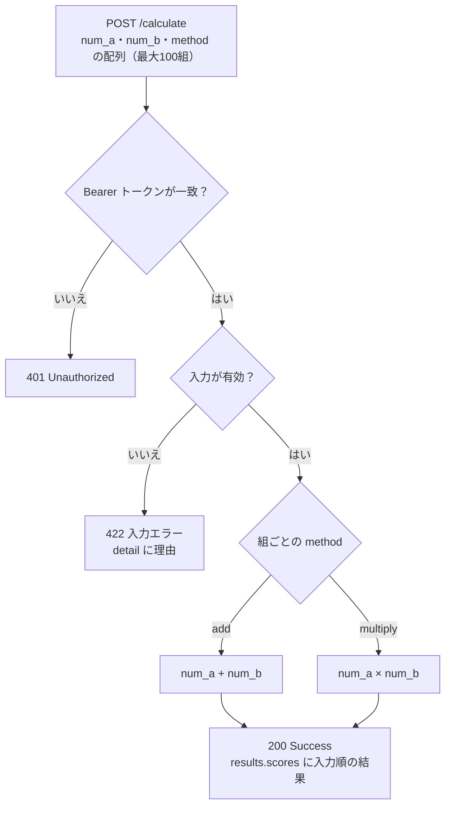

# FastAPI の計算 API サンプル

## HTTP リクエストの流れ



## 動かし方

### FastAPI

```sh
uvicorn app:app --host 0.0.0.0 --port 8000
```

### Swagger UI

http://127.0.0.1:8000/docs

**Authorize** に `sample-token` を入力し、**Try it out** で試す。

### Locust UI

FastAPI を起動したまま、別のターミナルで実行する。

```sh
locust --host http://127.0.0.1:8000
```

http://127.0.0.1:8089

### curl

```sh
curl -i http://127.0.0.1:8000/calculate \
  -H 'Content-Type: application/json' \
  -H 'Authorization: Bearer sample-token' \
  --data '[
    {"num_a": 3, "num_b": 4, "method": "add"},
    {"num_a": 3, "num_b": 4, "method": "multiply"}
  ]'
```

## 計算 API


